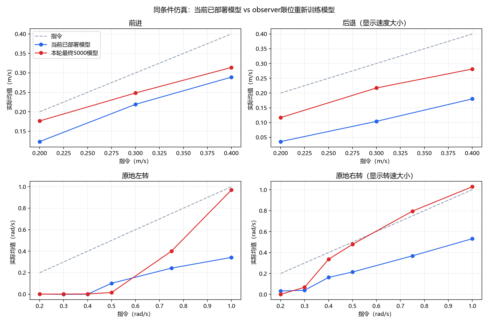

# 当前部署模型与新模型：分速度响应对比

当前基线为部署记录/本地SHA确认的ae59d61a；机器人192.168.137.101接口超时，未实时复核。新模型为本轮5000最终e3b90ac0。不是最初9599 donor。

每个模型30种输入×16环境×10秒。2秒给指令，8秒松开；表中速度为4–8秒均值，倒地后数据屏蔽。共同HD1910运行近似；两者scale1、无EMA。不是实机测量。

初始qpos/qvel匹配30/30；不证明所有潜在物理随机量完全一致。

| 输入 vx / yaw | 当前实际 vx / vy / yaw | 新实际 vx / vy / yaw | 未倒（当前/新） |
|---|---|---|---|
| forward20: +0.200 / +0.000 | +0.123 / -0.034 / -0.025 | +0.176 / +0.004 / -0.029 | 16/16 · 16/16 |
| back20: -0.200 / +0.000 | -0.036 / -0.024 / -0.055 | -0.117 / -0.003 / -0.151 | 16/16 · 16/16 |
| forward30: +0.300 / +0.000 | +0.219 / -0.032 / -0.012 | +0.248 / +0.010 / +0.051 | 16/16 · 16/16 |
| back30: -0.300 / +0.000 | -0.104 / -0.025 / -0.071 | -0.217 / -0.011 / -0.153 | 16/16 · 16/16 |
| forward40: +0.400 / +0.000 | +0.289 / -0.034 / -0.046 | +0.314 / +0.015 / +0.076 | 16/16 · 16/16 |
| back40: -0.400 / +0.000 | -0.180 / -0.050 / +0.074 | -0.281 / -0.013 / -0.047 | 16/16 · 16/16 |
| yaw_left_0.2: +0.000 / +0.200 | +0.000 / -0.000 / +0.001 | +0.000 / +0.000 / +0.000 | 16/16 · 16/16 |
| yaw_right_0.2: +0.000 / -0.200 | +0.007 / -0.004 / -0.033 | -0.000 / -0.000 / -0.001 | 16/16 · 16/16 |
| yaw_left_0.3: +0.000 / +0.300 | +0.000 / -0.000 / -0.001 | +0.000 / +0.000 / +0.001 | 16/16 · 16/16 |
| yaw_right_0.3: +0.000 / -0.300 | +0.022 / -0.008 / -0.039 | +0.001 / -0.002 / -0.068 | 16/16 · 16/16 |
| yaw_left_0.4: +0.000 / +0.400 | +0.007 / -0.010 / -0.000 | +0.000 / +0.000 / +0.002 | 16/16 · 16/16 |
| yaw_right_0.4: +0.000 / -0.400 | +0.060 / -0.019 / -0.162 | +0.008 / -0.008 / -0.336 | 16/16 · 16/16 |
| yaw_left_0.5: +0.000 / +0.500 | +0.018 / -0.020 / +0.102 | +0.001 / -0.001 / +0.015 | 16/16 · 16/16 |
| yaw_right_0.5: +0.000 / -0.500 | +0.062 / -0.020 / -0.214 | +0.012 / -0.004 / -0.478 | 16/16 · 16/16 |
| yaw_left_0.75: +0.000 / +0.750 | +0.030 / -0.029 / +0.243 | +0.016 / -0.004 / +0.401 | 16/16 · 16/16 |
| yaw_right_0.75: +0.000 / -0.750 | +0.060 / -0.020 / -0.368 | +0.019 / +0.004 / -0.795 | 16/16 · 16/16 |
| yaw_left_1: +0.000 / +1.000 | +0.030 / -0.027 / +0.342 | +0.028 / +0.005 / +0.969 | 16/16 · 16/16 |
| yaw_right_1: +0.000 / -1.000 | +0.055 / -0.014 / -0.532 | +0.018 / +0.011 / -1.029 | 16/16 · 16/16 |
| arc_0.2_left_0.5: +0.200 / +0.500 | +0.143 / -0.030 / +0.189 | +0.180 / +0.003 / +0.436 | 16/16 · 16/16 |
| arc_0.2_right_0.5: +0.200 / -0.500 | +0.156 / -0.025 / -0.134 | +0.171 / +0.000 / -0.534 | 16/16 · 16/16 |
| arc_0.2_left_1: +0.200 / +1.000 | +0.153 / -0.027 / +0.467 | +0.176 / -0.002 / +0.986 | 16/16 · 16/16 |
| arc_0.2_right_1: +0.200 / -1.000 | +0.176 / -0.013 / -0.529 | +0.170 / +0.011 / -0.972 | 16/16 · 16/16 |
| arc_0.3_left_0.5: +0.300 / +0.500 | +0.220 / -0.038 / +0.277 | +0.252 / +0.004 / +0.481 | 16/16 · 16/16 |
| arc_0.3_right_0.5: +0.300 / -0.500 | +0.224 / -0.027 / -0.233 | +0.241 / +0.008 / -0.437 | 16/16 · 16/16 |
| arc_0.3_left_1: +0.300 / +1.000 | +0.227 / -0.037 / +0.576 | +0.247 / -0.010 / +0.946 | 16/16 · 16/16 |
| arc_0.3_right_1: +0.300 / -1.000 | +0.236 / -0.012 / -0.557 | +0.235 / +0.013 / -0.921 | 16/16 · 16/16 |
| arc_0.4_left_0.5: +0.400 / +0.500 | +0.289 / -0.042 / +0.266 | +0.320 / +0.003 / +0.501 | 16/16 · 16/16 |
| arc_0.4_right_0.5: +0.400 / -0.500 | +0.293 / -0.026 / -0.324 | +0.304 / +0.018 / -0.374 | 16/16 · 16/16 |
| arc_0.4_left_1: +0.400 / +1.000 | +0.288 / -0.048 / +0.596 | +0.315 / -0.018 / +0.934 | 16/16 · 16/16 |
| arc_0.4_right_1: +0.400 / -1.000 | +0.297 / -0.008 / -0.656 | +0.296 / +0.025 / -0.840 | 16/16 · 16/16 |

平移单位m/s，偏航单位rad/s。完整停止时间、髋偏航幅度见responses.csv。

